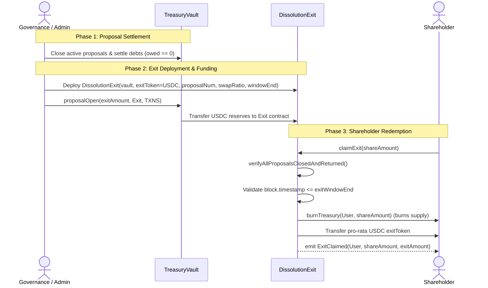

# Open Treasury: Dissolution Exit Specification and Architecture

This document defines the architecture, verification requirements, state validations, and token return mechanics for the `DissolutionExit.sol` contract (Type 2B / 2D Exit Policy).

---

## 1. Overview & Purpose

`DissolutionExit.sol` is designed for scenarios where an Open Treasury is winding down or undergoing full dissolution:
* **Scope**: Serves as the final liquidation vehicle for shareholders when the treasury vault ceases active operations.
* **Pre-condition**: Requires that all active proposals are closed and all borrowed/allocated capital has been fully settled and repaid to the treasury.
* **Redemption**: Allows shareholders to burn their treasury shares (`treasToken`) in exchange for their pro-rata distribution of the actual underlying reserve asset (`exitToken`, e.g., USDC).

---

## 2. Core Architecture & State Variables

`DissolutionExit` implements the standard `IExitPolicy` interface with the following state:

| Variable | Type | Description |
|---|---|---|
| `treasuryVault` | `address` | The immutable address of the `TreasuryVault` contract. |
| `exitToken` | `IERC20` | **Immutable reserve token** dispensed to exiting shareholders (e.g. USDC). |
| `proposalNum` | `uint256` | The specific exit proposal ID in the `TreasuryVault`. |
| `swapRatio` | `uint256` | The fixed exchange rate (scaled to `1e18`) of exit tokens per treasury token. |
| `exitWindowEnd` | `uint256` | Timestamp after which claims can no longer be processed (or `0` for unbounded). |

### Constructor Initialization
```solidity
constructor(
    address _treasuryVault,
    IERC20 _exitToken,
    uint256 _proposalNum,
    uint256 _swapRatio,
    uint256 _exitWindowEnd
) {
    require(_treasuryVault != address(0), "Invalid vault address");
    require(address(_exitToken) != address(0), "Invalid exit token");
    treasuryVault = _treasuryVault;
    exitToken = _exitToken;
    proposalNum = _proposalNum;
    swapRatio = _swapRatio;
    exitWindowEnd = _exitWindowEnd;
}
```

---

## 3. Token Return Architecture (Audit Finding #5 Fix)

### The Asset Mismatch Vulnerability (Finding #5)
In previous implementations, `claimExit` retrieved the exit asset dynamically via:
```solidity
// VULNERABLE:
IERC20 exitToken = IERC20(vault.asset());
```
Because `TreasuryVault` inherits `ERC4626(tToken)`, `vault.asset()` points to `treasToken` (the treasury's internal receipt token). Consequently:
1. Users burned `treasToken`.
2. Users received `treasToken` right back instead of the genuine backing reserve asset (e.g., USDC/DAI).
3. The treasury's actual liquidated reserves remained trapped in the contract.

### The Resolution
`DissolutionExit` stores the backing reserve asset explicitly as an immutable state variable:
```solidity
IERC20 public immutable exitToken;
```
During contract deployment, governance or the deploying script specifies the genuine reserve token (such as USDC). When `claimExit` executes, the contract:
1. **Burns input shares**: Calls `ITreasuryToken(address(treasToken)).burnTreasury(msg.sender, amount)` to properly reduce `totalSupply` (resolving Audit Finding #11).
2. **Returns real reserves**: Transfers `exitToken` (the actual backing asset) to `msg.sender`.

```
+-----------------------------------------------------------------+
|                       claimExit(amount)                         |
|                                                                 |
|  [User] ----- (amount) treasToken -----> [burnTreasury (Burn)]  |
|  [Exit Contract] ----- (exitAmount) exitToken -----> [User]     |
|                   (e.g., USDC Reserve Asset)                    |
+-----------------------------------------------------------------+
```

---

## 4. Claim Validations & Security Controls

Before executing any distribution, `claimExit(uint256 amount)` enforces four levels of security checks:

### A. Full Dissolution Verification (`verifyAllProposalsClosedAndReturned`)
Before any shareholder can claim, the contract verifies that all outstanding treasury activity has halted:
```solidity
function verifyAllProposalsClosedAndReturned() public view returns (bool) {
    TreasuryVault vault = TreasuryVault(payable(treasuryVault));
    uint256 totalProposals = vault.proposalNum();
    for (uint256 i = 1; i <= totalProposals; i++) {
        if (i != proposalNum) {
            if (!vault.closedProposals(i)) {
                return false;
            }
            if (vault.owed(i) > 0) {
                return false;
            }
        }
    }
    return true;
}
```
* **Proposal Closure**: Ensures no unclosed proposals (`closedProposals[i] == false`) exist.
* **Debt Settlement**: Ensures no outstanding debts remain unpaid (`vault.owed(i) == 0`).
* **Isolation**: Skips the exit proposal itself (`i != proposalNum`).

### B. Time Window Validation
If an `exitWindowEnd` was configured (`!= 0`), the transaction reverts if the window has lapsed:
```solidity
if (exitWindowEnd != 0) {
    require(block.timestamp <= exitWindowEnd, "Exit window has ended");
}
```

### C. Pro-Rata Valuation & Contract Solvency
The payout amount is calculated using fixed 18-decimal fixed-point math:
```solidity
uint256 exitAmount = (amount * swapRatio) / 1e18;
require(exitAmount > 0, "Exit amount is zero");
require(exitToken.balanceOf(address(this)) >= exitAmount, "Insufficient exit tokens in contract");
```
* Ensures the output amount is strictly non-zero.
* Guarantees that the contract currently holds sufficient `exitToken` balance before attempting the transfer.

### D. Irreversible Share Burning (Finding #11 Fix)
Share tokens are burned directly using `burnTreasury`:
```solidity
ITreasuryToken(address(treasToken)).burnTreasury(msg.sender, amount);
exitToken.safeTransfer(msg.sender, exitAmount);
emit ExitClaimed(msg.sender, amount, exitAmount);
```

---

## 5. End-to-End Dissolution Workflow


