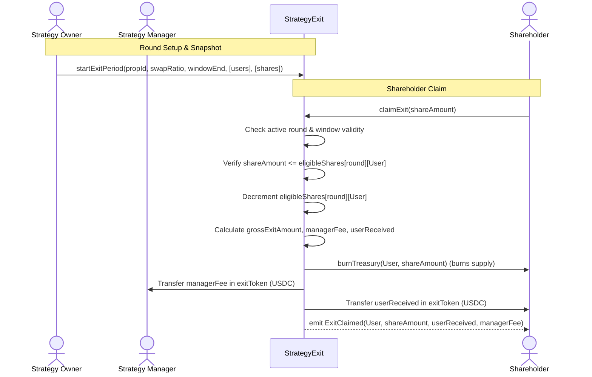

# Open Treasury: Strategy Exit Specification and Architecture

This document defines the architecture, fee distribution model, state validations, and token return mechanics for the `StrategyExit.sol` contract.

---

## 1. Overview & Purpose

`StrategyExit.sol` is an exit policy designed for actively managed strategy vaults where performance or management fees are deducted before dispensing liquidated assets to exiting shareholders:
* **Fee Structure**: Enforces an immutable fee percentage (`managerFeeBps`, e.g., 2000 = 20%) allocated directly to a designated manager address.
* **Reusable Multi-Round Sessions**: Designed as a persistent, reusable contract capable of executing multiple distinct exit periods over the strategy vault's lifetime.
* **Snapshot Protection**: Snapshots eligible users and their approved balances per round to prevent front-running and arbitrage.
* **Asset Distribution**: Burns shareholder treasury tokens and dispenses the actual backing reserve asset (`exitToken`, e.g., USDC) split between the user and strategy manager.

---

## 2. Core Architecture & State Variables

`StrategyExit` implements `IExitPolicy` and maintains the following state variables:

| Variable | Type | Description |
|---|---|---|
| `treasuryVault` | `address` | The immutable address of the `TreasuryVault`. |
| `exitToken` | `IERC20` | **Immutable reserve token** dispensed to shareholders and manager (e.g. USDC). |
| `owner` | `address` | The administrator authorized to trigger and configure new exit rounds. |
| `managerAddress` | `address` | Recipient address for the management fee split. Updatable by manager or owner. |
| `managerFeeBps` | `uint256` | Immutable basis points fee structure (max `10000` = 100%). |
| `currentRound` | `uint256` | Monotonically increasing counter of the active exit period. |
| `exitPeriods` | `mapping(uint256 => ExitPeriod)` | Round configuration (`proposalNum`, `swapRatio`, `exitWindowEnd`, `isActive`). |
| `eligibleShares` | `mapping(uint256 => mapping(address => uint256))` | Round snapshot mapping eligible user addresses to claimable share balances. |

### Constructor Initialization
```solidity
constructor(
    address _treasuryVault,
    IERC20 _exitToken,
    address _owner,
    address _managerAddress,
    uint256 _managerFeeBps
) {
    require(_treasuryVault != address(0), "Invalid vault address");
    require(address(_exitToken) != address(0), "Invalid exit token");
    require(_owner != address(0), "Invalid owner address");
    require(_managerAddress != address(0), "Invalid manager address");
    require(_managerFeeBps <= 10000, "Fee cannot exceed 100%");
    
    treasuryVault = _treasuryVault;
    exitToken = _exitToken;
    owner = _owner;
    managerAddress = _managerAddress;
    managerFeeBps = _managerFeeBps;
}
```

---

## 3. Token Return Architecture (Audit Findings #5 & #6 Fix)

### The Asset Mismatch Vulnerability
Previously, `claimExit` used:
```solidity
// VULNERABLE:
IERC20 exitToken = IERC20(vault.asset());
```
Because the `TreasuryVault` sets `ERC4626(tToken)`, calling `vault.asset()` returns `treasToken` (the treasury's internal receipt token). Consequently:
* Shareholders burned `treasToken` only to receive `treasToken` back.
* The manager received `treasToken` instead of actual revenue/fee earnings.
* The strategy's actual liquidated reserve assets (e.g., USDC) remained locked in the contract.

### The Resolution
`StrategyExit` explicitly defines `exitToken` as an immutable ERC20 token passed at deployment:
```solidity
IERC20 public immutable exitToken;
```
During claims, all payouts (both the user payout and the manager fee) are denominated and executed in `exitToken`:

```
+---------------------------------------------------------------------------------+
|                               claimExit(amount)                                 |
|                                                                                 |
|  [User] ----- (amount) treasToken -----> [burnTreasury (Burn)]                  |
|                                                                                 |
|  [Gross Output: (amount * swapRatio) / 1e18 in exitToken]                       |
|        |                                                                        |
|        +---- (managerFee) exitToken ------> [managerAddress]                    |
|        |                                                                        |
|        +---- (userReceived) exitToken ----> [User]                              |
+---------------------------------------------------------------------------------+
```

---

## 4. Fee Split & Calculation Mechanics

During `claimExit(uint256 amount)`:
1. **Gross Valuation**:
   ```solidity
   uint256 grossExitAmount = (amount * period.swapRatio) / 1e18;
   require(grossExitAmount > 0, "Exit amount is zero");
   require(exitToken.balanceOf(address(this)) >= grossExitAmount, "Insufficient exit tokens in contract");
   ```
2. **Fee Calculation**:
   ```solidity
   uint256 managerFee = (grossExitAmount * managerFeeBps) / 10000;
   uint256 userReceived = grossExitAmount - managerFee;
   ```
3. **Execution**:
   * Burn user's treasury tokens (reducing total supply):
     ```solidity
     ITreasuryToken(address(treasToken)).burnTreasury(msg.sender, amount);
     ```
   * Dispense manager fee (if `managerFee > 0`):
     ```solidity
     exitToken.safeTransfer(managerAddress, managerFee);
     ```
   * Dispense net proceeds to shareholder:
     ```solidity
     exitToken.safeTransfer(msg.sender, userReceived);
     ```
   * Emit audit event:
     ```solidity
     emit ExitClaimed(msg.sender, amount, userReceived, managerFee);
     ```

---

## 5. Round Lifecycle & Snapshot Management

1. **Start Period**:
   The owner calls `startExitPeriod(proposalNum, swapRatio, exitWindowEnd, eligibleUsers, eligibleBalances)`:
   * Deactivates the prior round (`exitPeriods[currentRound].isActive = false`).
   * Increments `currentRound`.
   * Sets new round parameters in `ExitPeriod`.
   * Populates `eligibleShares[currentRound][user] = balance`.

2. **Snapshot Enforcement**:
   * Users can only redeem up to `eligibleShares[round][msg.sender]`.
   * Double-spend is prevented by deducting claimed shares immediately:
     ```solidity
     eligibleShares[round][msg.sender] -= amount;
     ```

3. **Time Window**:
   * If `exitWindowEnd != 0`, requires `block.timestamp <= period.exitWindowEnd`.

---

## 6. End-to-End Strategy Exit Sequence


