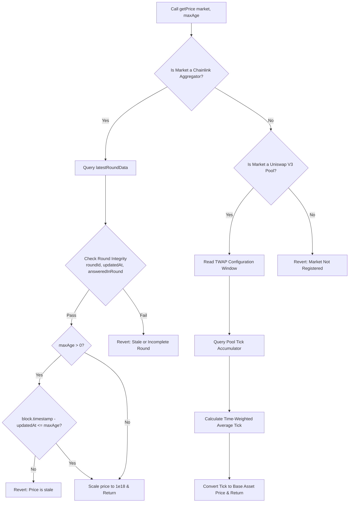

# Open Treasury: Price Oracle Specification

This document outlines the architectural workflows for the `OracleRouter.sol` module. The Oracle Router serves as the unified pricing engine by policy contracts.

## 1. Core Principles

*   **Market-Keyed Architecture :** The Oracle Router is a shared global contract. The router registry is keyed by the **Market Contract Address** (the specific Uniswap V3 Pool address or Chainlink Aggregator address) instead of the token address.
*   **Direct Asset Denomination (No USD Requirement):** Prices are returned in the denomination of the registered market. 
    *   Registers the `WETH/WBTC` pool, the price of WETH is returned in `WBTC` terms.
    *   Allows any treasury to support arbitrary base assets natively.
*   **Scale Standard:** All returned values are scaled to `1e18` (18 decimals) to ensure compatibility with standard ERC-20 decimal math.
*   **Registry Reuse:** When registering a market, the router checks if it is already registered. If so, it reuses the existing configuration to save gas.

---

## 2. Price Feed Integration Types

The `OracleRouter` supports two distinct pricing sources:

### 2.1 Chainlink Price Feeds (Standard)
*   The owner registers the token's specific Chainlink Aggregator contract address.
*   **Round Integrity Guarantees:** Every Chainlink query rigorously validates data freshness and round sequencing via `latestRoundData()`:
    *   `answer > 0`: Rejects non-positive or negative prices.
    *   `updatedAt != 0`: Rejects unfinalized or incomplete rounds.
    *   `answeredInRound >= roundId`: Guards against carried-over stale round responses.
    *   `block.timestamp >= updatedAt`: Protects against future-dated timestamps or clock drift.
*   **Dynamic Policy-Specified Heartbeat (`maxAge`):** Because `OracleRouter` is a shared global pricing engine utilized across multiple treasuries and policies with varying risk profiles, staleness is configured dynamically by the consuming policy rather than hardcoded globally:
    *   `getPrice(market, maxAge)`: Allows policies to demand their required freshness window (e.g., a high-frequency liquidation engine enforcing `maxAge = 3600` [1 hour], while passive accounting might tolerate `maxAge = 86400` [24 hours]).
    *   `getPrice(market)`: Standard interface defaulting to `maxAge = 0` (enforcing full round integrity and sequencing without a fixed time expiry).
*   **Scale Standard:** The router dynamically scales the returned value (typically 8 decimals) to the standard 18 decimals (`1e18`) based on the aggregator's configured decimals.

### 2.2 Uniswap V3 TWAP Feeds (Long-Tail / Niche Assets)
*   The owner registers the specific Uniswap V3 pool address.
*   To prevent flash-loan spot price manipulation, the router queries the **Time-Weighted Average Price (TWAP)** over a configurable window.
*   **TWAP Configuration:** The time window (in seconds) used to calculate the average price is configured per pool (e.g. 1800 seconds for 30 minutes, or 3600 seconds for 1 hour). A longer window increases resistance to manipulation, while a shorter window updates faster.
*   **Constraint:** The registered Uniswap pool must pair the collateral token with the Treasury's base asset (e.g. `COLLATERAL/BASE_ASSET`).

---

## 3. Workflow & Routing Logic

When `getPrice` is called, the router evaluates the registered market address type:



---

## 4. Smart Contract Interface

Every compliant price oracle module implements the extended pricing interface:

```solidity
// SPDX-License-Identifier: MIT
pragma solidity ^0.8.20;

interface IPriceOracle {
    /**
     * @dev Returns the price of a token from a registered market.
     * @param market The address of the registered Uniswap Pool or Chainlink Aggregator.
     * @return price The price scaled to 1e18.
     */
    function getPrice(address market) external view returns (uint256);

    /**
     * @dev Returns the price of a token from a registered market with a maximum staleness check.
     * @param market The address of the registered Uniswap Pool or Chainlink Aggregator.
     * @param maxAge Maximum age of price update in seconds (0 = skip staleness window check).
     * @return price The price scaled to 1e18.
     */
    function getPrice(address market, uint256 maxAge) external view returns (uint256);
}
```
